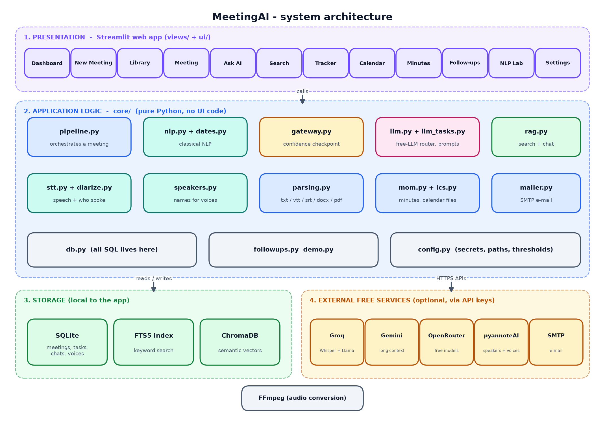
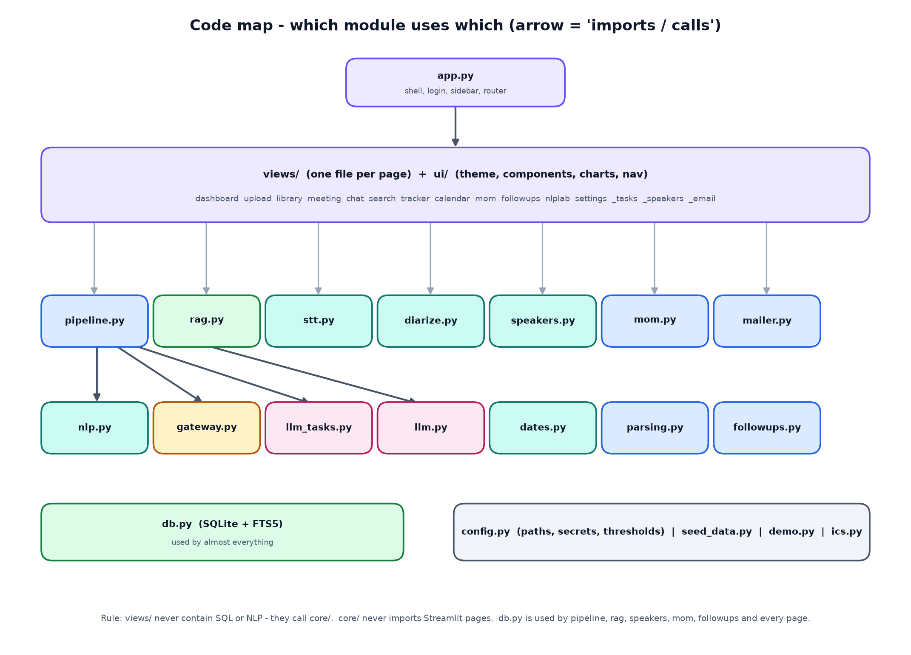

# MeetingAI - Code Walkthrough

**Every source file explained: what it does, how it works, and how the pieces fit together.**

| | |
|---|---|
| **Live application** | [{{SITE_URL}}]({{SITE_URL}}) |
| **Source code** | [{{REPO_URL}}]({{REPO_URL}}) |
| **Size** | about 7,700 lines of Python in 50 source files, plus 79 automated tests |
| **Companion document** | *MeetingAI - Project Report* (architecture, screenshots, design decisions) |

<pagebreak>

## Contents

1. How to read this document
2. The big picture
3. How a Streamlit app runs (and why it matters for the code)
4. Repository layout
5. `app.py` - the entry point
6. `core/` - the application logic (file by file)
7. `ui/` - theme and reusable components
8. `views/` - one file per page
9. Tests
10. Configuration and deployment files
11. Recipes: how to extend the project
12. Design rules and gotchas

---

## 1. How to read this document

Each file has four short parts:

- **Purpose** - what the file is for, in one or two sentences.
- **Key pieces** - the important functions/classes, each with a one-line description.
- **How it works** - the logic in plain language.
- **Talks to** - which other files it uses, so you can follow the flow.

Function names are real; you can search for them in the code.

## 2. The big picture





Three rules keep the code understandable:

1. **`views/` draws, `core/` thinks.** Pages contain no SQL and no NLP; they call functions in `core/`.
2. **`db.py` is the only file that writes SQL** (except small read queries in a few pages).
3. **Everything external is optional.** Each service (LLM, speech, speakers, e-mail) is checked at run time and has a fallback.

## 3. How a Streamlit app runs (and why it matters)

Streamlit **re-executes the whole script from top to bottom after every click or keystroke**. That has consequences visible all over the code:

- **`st.session_state`** keeps per-user values between re-runs (current page, selected meeting, chat session, cached suggestions). `ui/nav.py` is just helpers around it.
- **Navigation is a normal function call.** `nav.goto("meeting", meeting_id)` stores the page name and calls `st.rerun()`; `app.py` then imports and renders `views/<page>.py`.
- **Slow, reusable objects are cached** (`@st.cache_resource` for the trained classifier; module-level variables for the embedding model and the ChromaDB client).
- **Durable data goes to SQLite**, never only to session state.
- **Widgets need stable keys** (`key="m_trq"`) so Streamlit does not forget their value when the page re-runs.
- **Long jobs run synchronously** with a progress bar (`views/upload.py`), because the app is a single process on free hosting.

## 4. Repository layout

```
nlp+agentic ai/
├─ app.py                      entry point
├─ requirements.txt  packages.txt  requirements-local.txt
├─ .streamlit/  config.toml  secrets.toml.example
├─ core/    (19 files)  logic: parsing, speech, speakers, NLP, gateway, LLM, search, minutes, e-mail
├─ ui/      (4 files)   theme, components, charts, navigation
├─ views/   (15 files)  one file per page + 3 shared panels
├─ tests/   (9 files)   79 automated tests
└─ docs/    guides, reports, diagram and screenshot tools
```

<pagebreak>

## 5. `app.py` - the entry point

**Purpose.** Starts everything: page configuration, theme, optional password, sidebar, and the router that renders the selected page.

**Key pieces**

| Name | Description |
|---|---|
| `warm()` | `@st.cache_resource`. Creates the database schema and trains the classical NLP model once per server start |
| `login_gate()` | If the secret `APP_PASSWORD` exists, shows a password form and compares in constant time (`hmac.compare_digest`) |
| `sidebar()` | Logo, navigation buttons (primary style = current page), status card showing which services are connected, lock button |
| `main()` | Runs the gate, `warm()`, `sidebar()`, scrolls to the top after navigation (and collapses the sidebar on phones), then imports `views.<page>` and calls `render()` |

**How it works.** `st.set_page_config` must be the first Streamlit call, so it runs before other imports that use Streamlit. `theme.apply()` injects the CSS on every run. The selected page name comes from `ui/nav.current()`. Any exception inside a page is caught and shown as a friendly error plus a technical-details expander, so users never see a raw stack trace.

**Talks to.** `core.db`, `core.diarize`, `core.llm`, `core.mailer`, `core.stt` (status card), `ui.nav`, `ui.theme`, every `views.*` module.

---

## 6. `core/` - the application logic

### 6.1 `core/__init__.py`
A tiny compatibility shim. If the host's SQLite is older than 3.35 (ChromaDB needs newer), it swaps in `pysqlite3` when available. Does nothing on modern systems.

### 6.2 `core/config.py`
**Purpose.** One place for paths, defaults and secret lookup.

| Name | Description |
|---|---|
| `DATA_DIR`, `DB_PATH`, `UPLOAD_DIR`, `CHROMA_DIR`, `EXPORT_DIR` | Locations under `data/` (override with the `MEETINGAI_DATA` environment variable - tests use this) |
| `DEFAULT_THRESHOLDS` | Gateway defaults: classification 0.80, margin 0.15, owner 0.85, deadline 0.85, retrieval similarity 0.28 |
| `DEFAULT_MODELS` | Default free model names (Groq Llama, Gemini Flash, Whisper, OpenRouter) |
| `secret(name)` | Looks a value up in this order: **session override** (typed in Settings) > **Streamlit secrets** > **environment variable** > default |
| `set_session_key(name, value)` | Stores a key for the current browser session only |

**Gotcha handled.** Touching `st.secrets` when no secrets file exists makes Streamlit show a red banner, so `_secrets_file_exists()` checks first.

### 6.3 `core/db.py` - the database layer
**Purpose.** SQLite is the source of truth. Every table, and every function that reads or writes it, lives here.

**Schema (13 tables):** `meetings`, `segments` (+ virtual table `segments_fts`), `summaries`, `decisions`, `tasks`, `events`, `mom`, `chat_sessions`, `chat_messages`, `followups`, `analysis_log`, `email_log`, `voiceprints`, `settings`.

| Group | Functions |
|---|---|
| Plumbing | `conn()` (context manager, one short connection per call, thread lock), `init_db()` (creates tables, enables WAL, creates FTS5), `query`, `one`, `execute` |
| Settings | `get_setting`, `set_setting` (JSON values), `get_thresholds` (defaults merged with saved values) |
| Meetings | `create_meeting`, `update_meeting` (lists/dicts become JSON), `get_meeting`, `list_meetings` (search/status), `delete_meeting` (cascades to every table and the FTS index) |
| Transcript | `replace_segments` (also fills FTS), `get_segments`, `rename_speaker` (updates segments, task owners, decisions), `keyword_search` |
| Insights | `save_summary/get_summary`, `add_decision`, `list_decisions`, `add_task`, `list_tasks`, `update_task`, `add_event`, `list_events`, `clear_auto_items` (removes machine-made items before re-analysis, keeps manual ones) |
| Documents | `save_mom/get_mom` |
| Chat | `create_session`, `add_message`, `get_messages`, `list_sessions`, `delete_session` |
| Follow-ups & logs | `add_followup`, `list_followups`, `log_analysis`, `log_email` |
| Voices | `save_voiceprint`, `list_voiceprints`, `delete_voiceprint` |
| Stats | `dashboard_stats()` - all numbers shown on the dashboard |

**How `keyword_search` works.** It turns the query into an FTS5 expression (`"budget" OR "approval"`, or one quoted phrase), runs it against `segments_fts` with `bm25` ranking, and falls back to `LIKE` if FTS5 is unavailable.

### 6.4 `core/parsing.py` - reading transcripts
**Purpose.** Turn uploaded text files into `[{speaker, start, end, text}]`.

| Name | Description |
|---|---|
| `parse_transcript(name, bytes)` | Entry point. Detects VTT/SRT by `-->`, otherwise plain text; returns segments + header metadata |
| `extract_header_meta` | Reads `Meeting:`, `Date:`, `Attendees:`, `Agenda:` lines at the top |
| `parse_plain` | Recognises `Name: text` with optional `[mm:ss]` timestamps; joins continuation lines; ignores labels like `Note:`/`Agenda:` as speakers; fills `end` from the next start |
| `parse_cues` | VTT/SRT cues, `<v Name>` voice tags, merges adjacent cues of one speaker |
| `read_text_file` | Handles `.txt` (several encodings), `.docx` (python-docx), `.pdf` (pypdf) |
| `to_seconds`, `fmt_ts`, `segments_to_text` | Time helpers and the downloadable transcript format |

### 6.5 `core/stt.py` - speech-to-text
**Purpose.** Convert audio/video to timestamped text and (optionally) label speakers.

| Name | Description |
|---|---|
| `ffmpeg_path`, `probe_duration` | Locate FFmpeg; read the recording length |
| `make_chunks` | FFmpeg converts any file to mono 16 kHz 32 kbps MP3 and cuts it into 10-minute pieces so each upload stays under free-tier limits; returns `(file, offset_seconds)` |
| `_groq_transcribe` | Posts a chunk to Groq's Whisper API asking for segment **and word** timestamps; shifts times by the chunk offset; retries on HTTP 429 using `Retry-After`; drops likely-hallucinated segments |
| `_assemblyai_transcribe` | Upload, create transcript with speaker labels, poll until done |
| `_local_transcribe` | faster-whisper or openai-whisper if installed |
| `merge_short_segments` | Joins Whisper's short fragments into paragraphs (same speaker, small gap, max 60 words) |
| `choose_provider`, `provider_status` | Decide which engine to use |
| `transcribe(path, ..., speaker_engine, voiceprints)` | **The orchestrator**: ASR for every chunk, then (if enabled) diarization of the full audio and alignment; returns segments, duration, provider label, identified voices and warnings. If speaker identification fails it keeps a single speaker and returns a warning instead of failing |

### 6.6 `core/diarize.py` - who spoke when (pyannote)
**Purpose.** Everything about speakers: hosted pyannoteAI, local pyannote.audio, voiceprints, and alignment.

| Name | Description |
|---|---|
| `status()`, `choose_engine()` | Which speaker engines are available; preference order pyannoteAI > local pyannote > AssemblyAI |
| `_upload` | Declares a `media://` object, receives a pre-signed URL, `PUT`s the audio there |
| `_run_job` | Submits a job (`diarize`, `identify`, `voiceprint`), polls `/jobs/{id}` until it succeeds or fails; translates HTTP 401/402/429 into clear messages (`DiarizationError`) |
| `pyannoteai_diarize` / `pyannoteai_identify` / `pyannoteai_voiceprint` | The three hosted operations. *Identify* sends saved voiceprints with a match threshold and returns turns whose speaker is the matched **name** or the generic label |
| `local_diarize` | Loads `pyannote/speaker-diarization-3.1` with the Hugging Face token (handles old and new argument names) and runs it on a 16 kHz WAV |
| `diarize()` | Dispatcher used by `stt.transcribe` |
| `assign_speakers` | **Aligns text with speakers**: each Whisper word goes to the speaker whose turn contains its midpoint; one-word interjections are smoothed away; consecutive words of one speaker become one segment. Without words it uses the largest time overlap |
| `relabel_generic` | `SPEAKER_00` becomes `Speaker 1`... in order of first appearance; real names are left alone |
| `extract_voice_sample` | Cuts and joins the longest stretches of one speaker (FFmpeg `atrim` + `concat`) into a clip of at most 28 s - the input pyannoteAI needs for a voiceprint |
| `trim_clip` | Converts an uploaded/recorded voice clip to a 30-second mono MP3 |
| `match_threshold()` | Strictness (default 60/100), editable in Settings → Voices |

### 6.7 `core/speakers.py` - putting names on voices
**Purpose.** Suggest and apply names for anonymous speakers. Nothing is applied without the user's confirmation.

| Name | Description |
|---|---|
| `suggest_from_text` | Regex evidence: **self-introduction** ("I'm Priya", weight 3), **being addressed** ("Rahul, can you..." gives the *next* speaker, 1.2), **being thanked** ("Thanks Rahul" gives the *previous* speaker, 0.9), then **elimination**. Votes are matched greedily one name per speaker; confidence = `0.45 + 0.12 x votes` (max 0.95). Names must be in the attendee list when one exists |
| `suggest_with_llm` | Optional. Asks the LLM for a mapping **with evidence quotes**, verifies each quote against the transcript and the name against attendees/transcript |
| `suggest` | Combines both: rules win; agreement raises confidence |
| `speaker_samples` | The longest lines per speaker, shown beside the naming form |
| `apply_names` | Renames in segments, task owners and decisions, rebuilds the attendee list and refreshes the vector index |

### 6.8 `core/dates.py` - dates and times
**Purpose.** Find date expressions and convert them to calendar dates **relative to a base date** (the meeting date). Pure Python, no LLM.

| Name | Description |
|---|---|
| `find_dates(text, base)` | Returns `DateHit(phrase, iso, precision, time, kind)` for every expression: ISO dates, "25th October", "October 25", `13/11`, today/tomorrow/day after tomorrow, "in two weeks", "end of the week/month/quarter", EOD/COB, weekdays ("Monday", "next Friday", "this Friday"), "next week", and vague words |
| precision | `exact` (a date), `approx` ("next week": text only), `vague` ("soon", ambiguous `03/04`): **no calendar date is invented** |
| `find_time` | "3 PM", "10:30 am", "noon" |
| `strip_phrases` | Removes date phrases (and "by/on/before") when building a clean title |
| `pretty` | `Fri, 16 Oct 2026` or `Not specified` |

**Weekday rule.** "Monday" is the next Monday strictly after the base date; "next Monday" is the Monday of the following calendar week.

### 6.9 `core/seed_data.py`
**Purpose.** Training and test sentences for the classifier. `build_train()` expands hand-written templates (`"{P} will {V} {O} {D}."`) with names, verbs, objects and dates using a fixed random seed, giving **610 sentences** in four classes. `TEST_SET` holds **42 hand-written sentences in a different style**, never used for training, for the NLP Lab's evaluation. It is honest about being a *seed* corpus, not real meeting data.

### 6.10 `core/nlp.py` - classical NLP
**Purpose.** Everything that understands a sentence without an LLM.

| Group | Names | Description |
|---|---|---|
| Preprocessing | `clean_for_analysis`, `split_sentences`, `build_sentences` | Remove fillers, split sentences (abbreviation-safe), keep speaker/timestamp/previous speaker/next sentence in a `Sentence` object |
| Rules | `ACTION_CUES`, `DECISION_CUES`, `HEDGES`, `rule_scores` | Weighted regex cues combined as `1-(1-w1)(1-w2)...`; request wording beats a question mark; hedging detected |
| Statistics | `Classifier`, `get_classifier` | TF-IDF (1-2-grams) + `MultinomialNB(alpha=0.3)`, plus a logistic regression for comparison; trained from `seed_data` on first use |
| Fusion | `classify_batch`, `ClassResult` | `0.5 x NB + 0.5 x rules`; hedge x0.8; best label, confidence, margin |
| Evaluation | `evaluate_classifier` | Accuracy/F1/confusion matrix for NLP Lab |
| People | `find_people`, `is_real_speaker`, `_match_known`, `extract_owner` | Speaker names (excluding generic "Speaker 1"), first-name matching to full names, patterns for "I'll", "Priya will", "Priya, can you", "X is responsible for", "assigned to X", team names; confidence per pattern |
| Task details | `make_task_title`, `infer_priority`, `extract_deadline`, `extract_event` | Verb-first titles, High/Medium/Low priority words, deadline selection (prefers a date after "by/before/until", penalises dates from the next sentence), event detection (meeting nouns + exact date + optional time) |
| Candidates | `candidates_from`, `Candidate` | Applies everything and returns tasks/decisions with `kconf` and `kmargin` for the gateway |
| Offline summary | `key_terms`, `extractive_summary` | TF-IDF key phrases and centroid-similarity sentence ranking (boosting decisions and actions) used when no LLM is available |

### 6.11 `core/gateway.py` - the confidence gateway
**Purpose.** Decide whether a classical result is trusted. `evaluate(candidate, thresholds)` returns a `Decision` (accept, reason code, numbers, message). It checks **(1)** `kconf >= cls_threshold`, **(2)** `kmargin >= cls_margin`, then for tasks **(3)** owner confidence `>= owner_threshold`, **(4)** deadline not taken from the neighbouring sentence and exact-date confidence `>= deadline_threshold`. The first failure wins. `REASONS` maps each code to a human sentence. A vague deadline does *not* fail (the LLM cannot invent a date either).

### 6.12 `core/llm.py` - the free-LLM router
**Purpose.** Call Groq / Gemini / OpenRouter through their OpenAI-compatible HTTP API using only `requests`.

| Name | Description |
|---|---|
| `_providers()` | Builds the ordered provider list from available keys; Gemini first for long transcripts |
| `chat()` | Tries each provider and model; skips providers in cool-down; marks a provider as cooling for 45 s after HTTP 429; retries without `response_format` if a model rejects JSON mode; if a model is retired (HTTP 400/404 "model"), calls `discover_model` and tries the replacement once |
| `discover_model()` | Lists the provider's models and picks a suitable chat model (largest Llama / newest Gemini Flash / `:free` OpenRouter) |
| `extract_json`, `chat_json()` | Pulls JSON out of fenced or chatty answers, repairs trailing commas, asks the model to fix invalid JSON once |
| `test_connection()` | Used by Settings → Test connections |
| `ACTIVITY` | Small in-memory log of recent calls shown in Settings |

### 6.13 `core/llm_tasks.py` - prompts
**Purpose.** All prompts and their parsing helpers in one place. `SYSTEM_ANALYST` states the rules (use only the transcript, null when unknown, copy date phrases, quote evidence). `format_transcript` prints `[segment|time] speaker: text`. `chunk_ranges` splits long transcripts by word budget. `analyze_chunk` (summary + items), `merge_summaries` (reduce step), `adjudicate` (batch check of uncertain sentences), `answer` (grounded answers returning JSON with `found`, `answer`, `citations`), `polish_message` (tone-only rewrite).

### 6.14 `core/pipeline.py` - the orchestrator
**Purpose.** Run the whole analysis of one meeting and save it.

| Name | Description |
|---|---|
| `analyze(meeting_id, progress, use_llm)` | Steps 1-7 below; returns a `Result` (tasks, decisions, events, log, summary, stats) |
| `verify_quote` | Fuzzy-matches an LLM quote (RapidFuzz `partial_ratio` >= 82-92) against the segment it claims and then all segments |
| `validate_owner` | Accepts an owner only if it matches a participant or occurs in the transcript; "I" means the speaker; otherwise *Unassigned* + untrusted |
| `_resolve_deadline` | Converts an LLM-copied phrase with `dates.py` and checks that the phrase occurs nearby |
| `_find_match` | Links an LLM item to an existing classical item (same/adjacent segment and similar title) |
| `_build_summary` | LLM summary (merged for long meetings) or offline extractive summary |
| `save_results` | Replaces machine-extracted rows, writes the log and summary |
| `process_meeting` | `analyze` + `save_results` + index in ChromaDB + update attendees/duration/status + refresh follow-ups |

**`analyze` in order.** (1) build sentences and candidates; (2) gateway decisions; (3) LLM analysis pass per chunk (summary + independent items); (4) one adjudication call for uncertain candidates; (5) turn candidates into tasks/decisions (accepted, LLM-confirmed, review, or dropped) and log each decision; (6) merge the LLM's independent findings with validation, boosting agreement and flagging conflicts; (7) detect events on *all* sentences (scheduling sentences without a firm commitment go to the calendar, not the task list), de-duplicate tasks, build the summary.

### 6.15 `core/rag.py` - search and answers
**Purpose.** The semantic index, hybrid search, query router and grounded answers.

| Name | Description |
|---|---|
| `Embedder`, `get_embedder` | Backends: `onnx` (default, MiniLM, no PyTorch), `sbert` (BGE-small if installed), `hash` (offline lexical fallback). Embeddings are normalised; BGE queries get its instruction prefix |
| `_collection` | ChromaDB `PersistentClient` collection named per backend, cosine distance |
| `make_chunks` | About 110 words per chunk with small overlap, remembering segment range, start time and speakers |
| `index_meeting`, `reindex_items`, `rebuild_all`, `delete_index` | Maintain the vectors (transcript, decision and task documents) |
| `semantic_search` | Embed the query and query Chroma with optional meeting/kind filters |
| `route_query` | Detect intents (tasks, decisions, events, summary, phrase), meetings ("last three", a date, a title via fuzzy match) and a person |
| `hybrid_search` | Semantic + FTS5 keyword, merged with Reciprocal Rank Fusion (`1/(60+rank)`), overlapping ranges merged |
| `is_relevant`, `lexical_overlap`, `content_tokens` | Relevance gate: similarity threshold or word overlap with light stemming |
| `answer_question` | Route, retrieve, gate, build labelled evidence ([E], [T], [D], [V], [S]), ask the LLM, verify citations and support, or fall back to a direct retrieval answer |

### 6.16 `core/mom.py` - minutes and document rendering
**Purpose.** Generate the minutes and render any Markdown to HTML, Word and PDF.

| Name | Description |
|---|---|
| `generate_markdown` | Builds the minutes from saved data (details, attendees, agenda, summary, highlights, decisions table, action-item table, events, conclusions); uncertain rows get a warning mark |
| `md_blocks` | A small Markdown parser: headings, paragraphs (two trailing spaces = line break), bullet/numbered lists, tables, code blocks, images, page breaks |
| `to_html` | E-mail/preview HTML with inline styles (links, bold, italic, code) |
| `to_docx` | python-docx: headings, lists, tables, hyperlinks, images, page breaks |
| `to_pdf` | ReportLab: styled tables with automatic column widths, images, links; `_pdf_safe` maps symbols the built-in fonts lack |
| `to_plain` | Plain-text body for e-mail |

The same renderer builds the project documents you are reading.

### 6.17 `core/mailer.py` - e-mail
`parse_recipients` splits free text into valid and invalid addresses; `smtp_config` reads host/port/user/password/security from secrets or the session; `build_message` makes a multipart message (text + HTML + attachments); `send` supports STARTTLS, SSL or plain, never raises and returns `(ok, message)` with a friendly hint for Gmail login errors; `mailto_link` is the no-SMTP fallback.

### 6.18 `core/ics.py`
`build_ics` writes an iCalendar file (all-day or timed events); `google_calendar_link` builds an "add to Google Calendar" URL so no OAuth is needed.

### 6.19 `core/followups.py`
`refresh(meeting_id)` regenerates the *suggested* drafts: a recap (decisions + actions), one reminder per owner (a gentler "nudge" when something is overdue), an *owners needed* message for unassigned tasks, and reminders for upcoming events. `polish` asks the LLM to improve tone without changing facts. Drafts are stored as `suggested`; sending happens only in the UI after confirmation.

### 6.20 `core/demo.py`
Three realistic sample meetings with dates **relative to today**, so the calendar and tracker always have upcoming and overdue items. `load_demo` parses them like uploads and runs the full pipeline.

<pagebreak>

## 7. `ui/` - theme and reusable components

| File | What it does |
|---|---|
| `ui/theme.py` | `apply()` injects ~240 lines of CSS: colour variables, navy/violet background gradients, glass cards, sidebar styling, buttons, inputs, tabs, chat bubbles, transcript rows, calendar grid, stepper, animations, and responsive rules (stacked columns and smaller cards on phones) |
| `ui/components.py` | HTML builders: `H` (collapses indented HTML so Markdown does not treat it as code), `md`, `chip`, `status_chip`, `page_header`, `section`, `metric`/`metric_row`, `empty_state`, `transcript_html` (avatars, timestamps, highlights, insight tags), `month_grid`, `stepper`, `source_card`, `color_for`/`initials` for speaker avatars, `esc` (HTML-escape every piece of user text) |
| `ui/charts.py` | Plotly helpers (`donut`, `hbar`, `vbar`) with a transparent background, shared palette and fonts |
| `ui/nav.py` | `PAGES` (sidebar structure), `goto(page, meeting_id, **state)` (set state + `st.rerun`), `current()` |

---

## 8. `views/` - one file per page

Every file exposes `render()`.

| File | Page | How it works |
|---|---|---|
| `dashboard.py` | Dashboard | `db.dashboard_stats()` drives metric cards; recent meetings, deadlines/events list, task-status donut, owner workload bars, gateway health bars. Empty state offers sample data |
| `upload.py` | New Meeting | Tabs for file upload and pasted text. `_run()` creates the meeting, parses or transcribes, runs `pipeline.process_meeting` with a live stepper, handles errors by deleting the half-created meeting, and shows a result banner with speaker/AI warnings |
| `library.py` | Meeting Library | Search, sort, filter; two-column cards; open / ask AI / delete (with confirmation) |
| `meeting.py` | Meeting details | Tabs: Overview, Transcript (search, speaker filter, insight chips, audio player, download, *Who is who?*), Action items (`_tasks.task_table`), Decisions & events, How it was analysed (gateway log) |
| `chat.py` | Ask MeetingAI | Session list, scope selector, suggested questions, `rag.answer_question`, typing effect, sources and "how I searched" expanders, saved history |
| `search.py` | Search | Modes (smart/keyword/semantic/phrase), meeting and date filters, optional grounded answer, highlighted results, related tasks/decisions |
| `tracker.py` | Action Tracker | Metrics, filters, sorted editable table, manual task form |
| `calendar.py` | Calendar | Month navigation in `st.session_state["cal_ym"]`, grid from `components.month_grid`, agenda list, Google links, `.ics` download, manual events |
| `mom.py` | Minutes of Meeting | Generate, Edit/Preview/Export tabs, accept, downloads, recipients validation, e-mail preview, confirmation, send, history |
| `followups.py` | Follow-ups | Cards for each draft with edit, AI polish, save, mail-app link, dismiss and confirmed send |
| `nlplab.py` | NLP Lab | Live analysis of pasted text (scores, owner, deadline, event, gateway verdict), evaluation charts and confusion matrix, threshold simulator, gateway statistics, embedding similarity demo |
| `settings.py` | Settings | AI & speech (keys, test, engines), Voices (`_voices_tab`), Confidence gateway sliders, E-mail, Data & backup (zip backup/restore with path-traversal check, rebuild index, delete all), About |
| `_tasks.py` | shared | `build_frame` -> `st.data_editor`; `task_table` diffs the edited table against the original and writes only changes (and refreshes the vector index); `add_task_form` |
| `_speakers.py` | shared | The *Who is who?* panel: suggestions, audio sample players, name inputs, *Remember this voice* (`_enroll` cuts a sample and creates a voiceprint), *Apply names* |
| `_email.py` | shared | `setup_panel`: inline "connect your e-mail" form with provider presets (Gmail/Outlook/Yahoo) |

---

## 9. Tests (`tests/`)

| File | Tests | What it proves |
|---|---|---|
| `conftest.py` | - | Isolates every run in a temporary data folder and removes API keys from the environment |
| `test_dates.py` | 8 | Weekday and relative-date rules, vague phrases give no date, no false positives |
| `test_nlp.py` | 10 | Owners, deadlines, hedging, decisions, events, classifier accuracy floor |
| `test_parsing.py` | 5 | Speaker lines, headers, VTT, non-speaker labels, empty file |
| `test_pipeline.py` | 13 | Sample meetings end to end, search, "not found", minutes export, **LLM path with a fake LLM** (hallucinated quote and owner rejected) |
| `test_llm_router.py` | 4 | Fake HTTP servers: rate-limit fall-through, model discovery, JSON repair, total failure |
| `test_io.py` | 7 | Recipient parsing, SMTP against a local server, `.ics`, FFmpeg chunking with a fake ASR |
| `test_diarize.py` | 17 | Alignment, fake pyannoteAI server (upload/diarize/identify/voiceprint), failure fallback, voice sample cutting, name suggestions, applying names |
| `test_ui_smoke.py` | 4+ | Every page renders (AppTest), chat round trip, *Who is who?* suggests and applies names, Voices tab |

Run everything with `python -m pytest tests -q`.

---

## 10. Configuration and deployment files

| File | Purpose |
|---|---|
| `requirements.txt` | Streamlit, pandas, numpy, plotly, requests, scikit-learn, rapidfuzz, chromadb, onnxruntime, python-docx, reportlab, pypdf |
| `packages.txt` | `ffmpeg`, installed by Streamlit Cloud |
| `requirements-local.txt` | Optional `pyannote.audio` + `torch` for local diarization |
| `.streamlit/config.toml` | Dark theme colours, 200 MB upload limit, no usage statistics |
| `.streamlit/secrets.toml.example` | Template for all keys (Groq, Gemini, pyannoteAI, AssemblyAI, SMTP, APP_PASSWORD) |
| `.gitignore` | Keeps secrets, the `data/` folder and caches out of Git |
| `docs/` | `PROJECT_GUIDE`, `MeetingAI_Project_Report`, this walkthrough (Markdown, Word, PDF), and `tools/` that regenerate screenshots, diagrams and documents |

---

## 11. Recipes: how to extend the project

**Add a new page.** Create `views/mypage.py` with `render()`; add `("mypage", "My Page", "material_icon")` to `PAGES` in `ui/nav.py`. `app.py` imports it automatically.

**Add a new kind of extraction (for example "risks").** Add cue patterns and a label in `nlp.py`, a field/table in `db.py`, a branch in `pipeline.analyze`, and a view. Add seed sentences so the classifier learns the new label.

**Add an LLM provider.** Add a dict to `_providers()` in `llm.py` (base URL, key name, models). Anything with an OpenAI-compatible `/chat/completions` endpoint works.

**Change the thresholds.** Settings → Confidence gateway (or `DEFAULT_THRESHOLDS`), then use NLP Lab → Threshold simulator to see the effect.

**Use a different embedding model.** Set `EMBEDDING_BACKEND` (`onnx`, `sbert`, `hash`); the collection name changes with the backend, then rebuild the index in Settings.

**Support another speaker engine.** Add a branch in `diarize.diarize()` that returns `DiarizationResult(turns=[{speaker,start,end}], ...)`; alignment and naming work unchanged.

## 12. Design rules and gotchas

- **Never invent.** Unknown owner = *Unassigned*; unknown date = *Not specified*; no evidence = "not found".
- **Dates are computed by code**, never by an LLM.
- **LLM output is untrusted data** and must pass `pipeline` validation.
- **External actions need a confirmation click** (e-mail, follow-ups, calendar links).
- **Escape user text** with `components.esc` before putting it into HTML.
- **Indented HTML inside Markdown** becomes a code block; `components.H` strips indentation.
- **Hidden control characters.** If a regular expression ever stops matching, check for stray backspace characters (`\x08`) where `\b` was intended.
- **Free hosting forgets files**; the backup/restore feature exists for that reason.
- **Keep views thin.** If a page needs a new rule, put it in `core/` and test it there.
