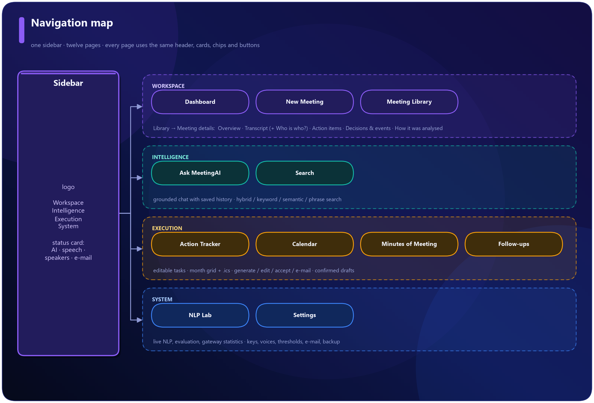
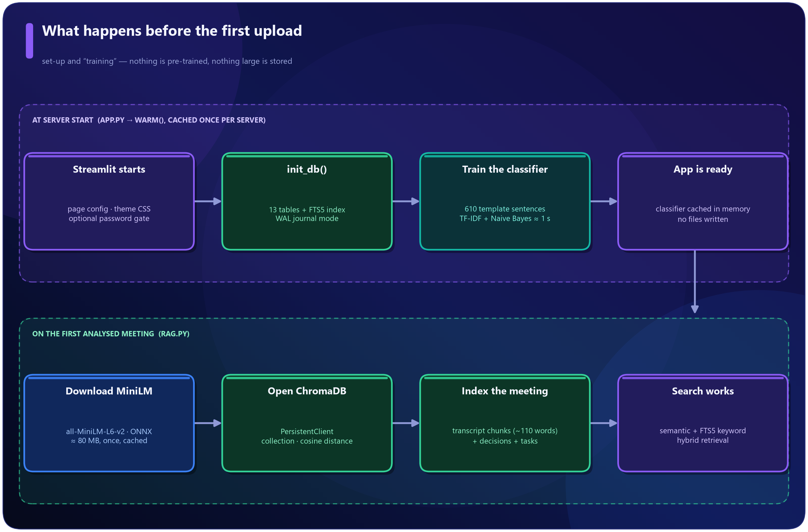
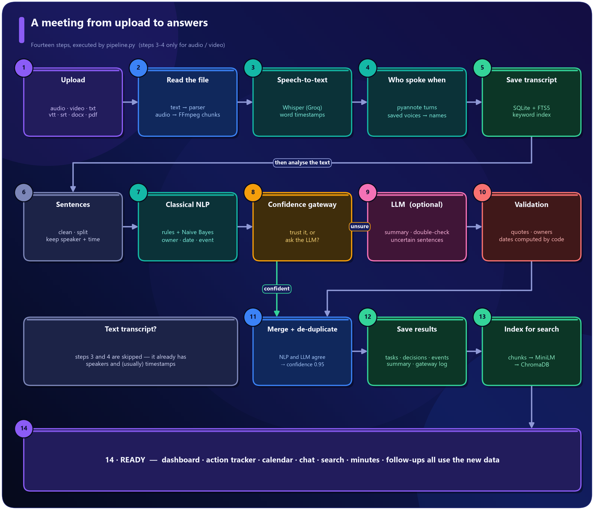
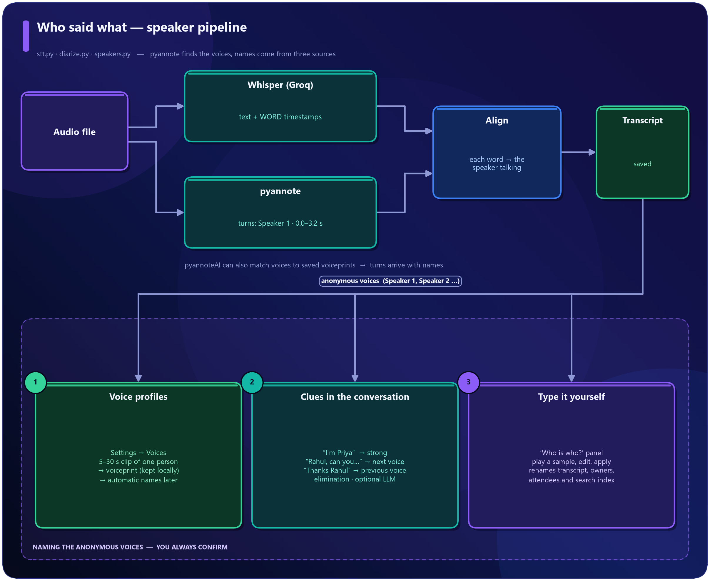
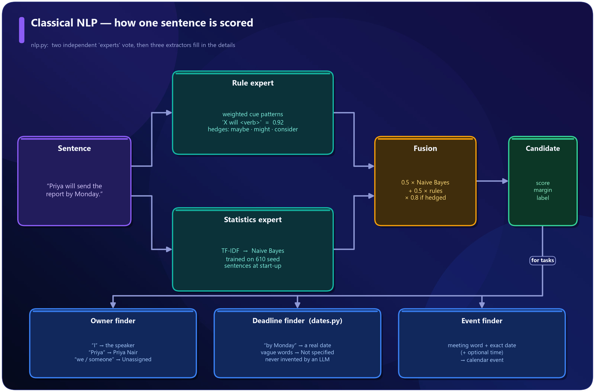
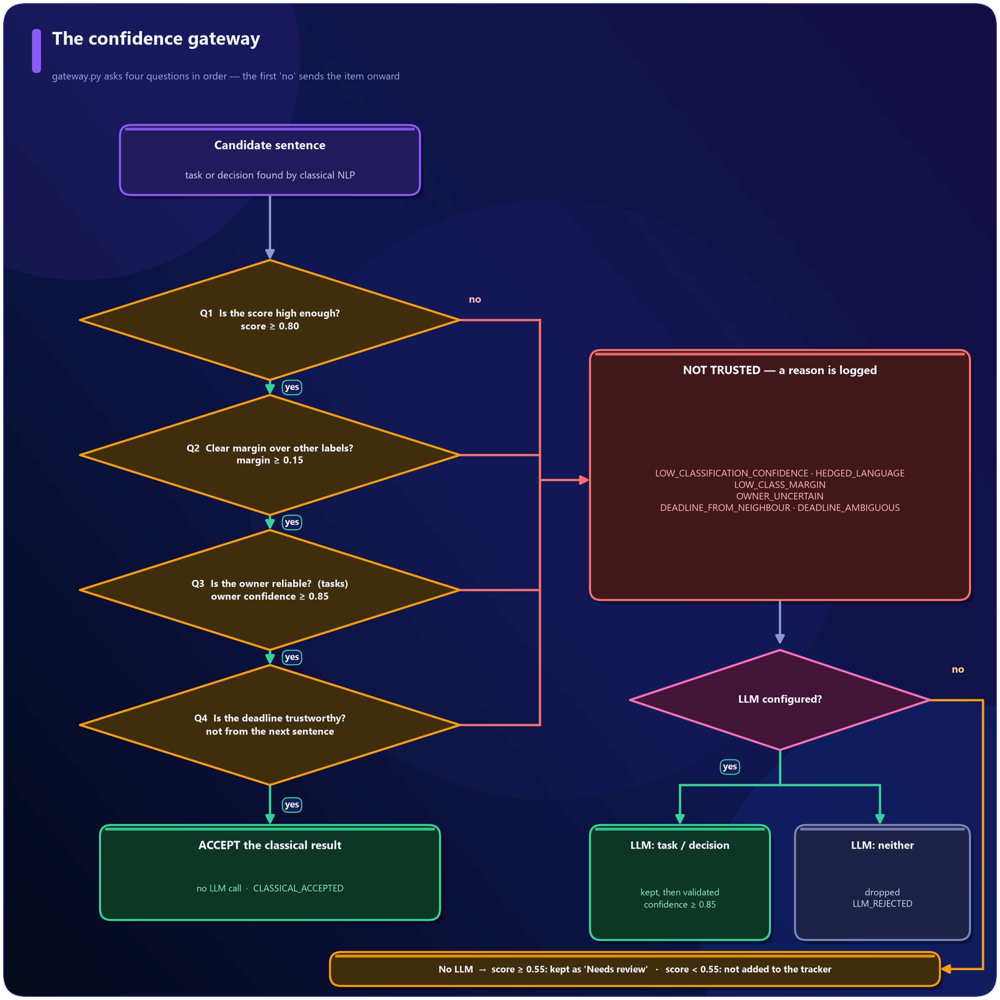
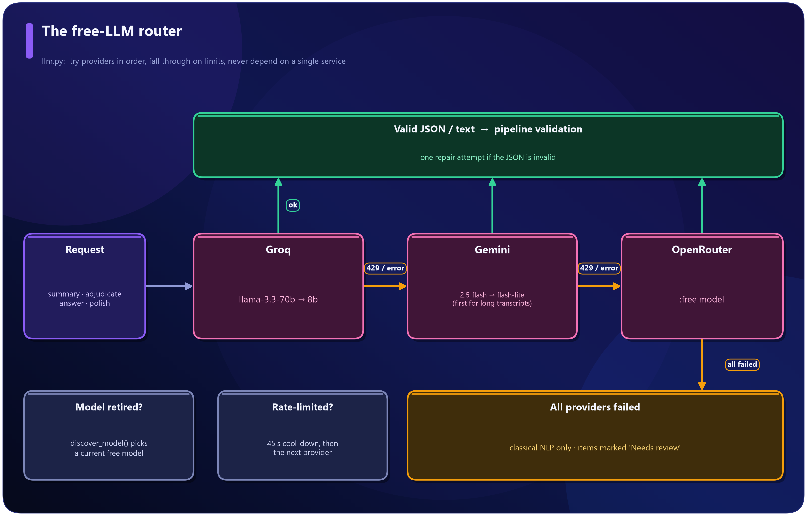
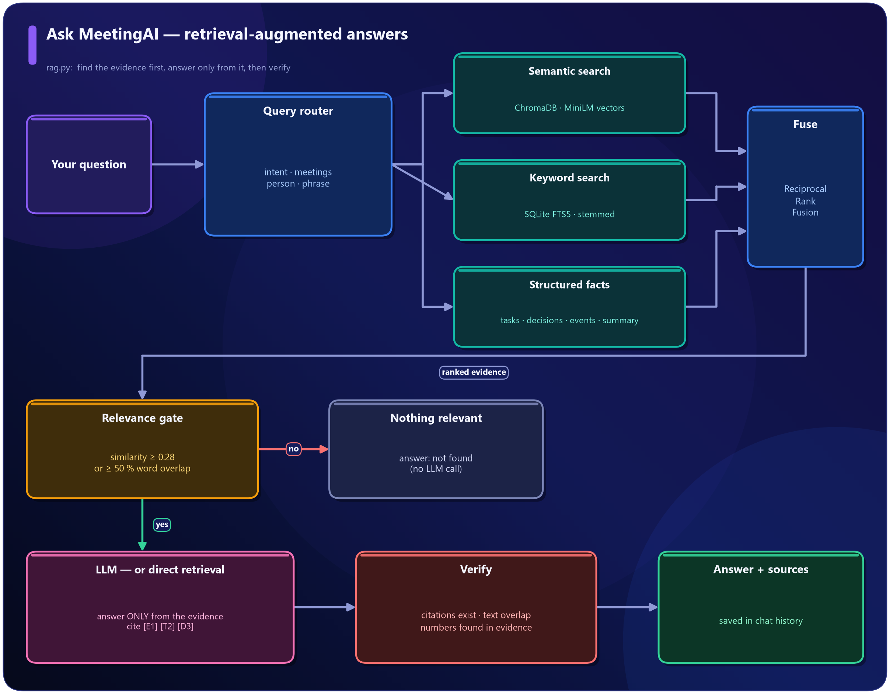
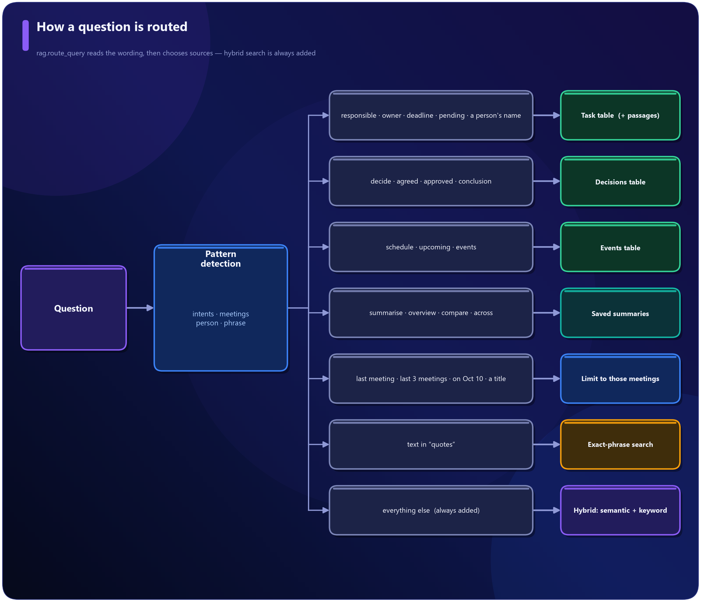
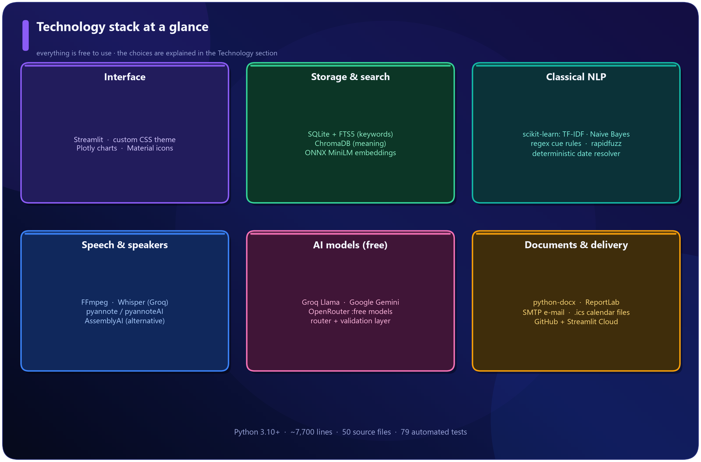

# MeetingAI - Project Report

## 1. Executive summary
LEAD: A meeting assistant that listens, remembers, organises and answers - and says so honestly when it does not know.

Meetings produce decisions, promises and deadlines, and most of them are forgotten within days. **MeetingAI** turns a meeting recording or a written transcript into organised, searchable knowledge. It runs as a web application built entirely in Python and can be deployed for free.

```stats
12 | application pages
14 | processing steps per meeting
610 | seed sentences used to train the classifier
16 | free services & libraries combined
0 | paid components required
```


**What a user gets from one upload**

- A **transcript** with timestamps and **speaker names** ("Priya: ...", not "Speaker 2") using pyannote speaker recognition.
- A structured **summary**: overview, key discussion points, decisions and conclusions.
- **Action items** with owner, deadline, priority and status. When the meeting did not say who or when, the application shows **Unassigned** or **Not specified** instead of guessing.
- **Decisions** with the exact quote that proves them, and **dated events** that are placed on a **calendar** automatically.
- A **chatbot** and a **cross-meeting search** whose answers come only from the meetings and always show their sources.
- Editable **Minutes of Meeting** (Word, PDF, Markdown) that can be **e-mailed** after you confirm.
- **Follow-up suggestions** (recaps, reminders) that stay drafts until you approve them.

> [!KEY] What makes the project different
> - **Hybrid NLP.** Fast, explainable classical NLP runs first. A *confidence gateway* sends only doubtful sentences to a free LLM.
> - **Validation.** Everything an LLM returns is checked against the real transcript (verbatim quotes, real owners, dates computed by code).
> - **Honesty.** Unknown owner = *Unassigned*, unknown date = *Not specified*, unanswerable question = *not found*.
> - **Runs free.** Free-tier LLMs, a local embedding model, SQLite and ChromaDB - deployable on Streamlit Community Cloud.

## 2. The problem, the objectives and the scope
LEAD: Why the project exists, what it had to achieve, and where its boundaries are.

**The problem.** Important information is buried in long conversations. Manual minutes take time, ordinary transcription gives a wall of text without understanding, and general-purpose chatbots may invent facts that were never said.

### 2.1 Objectives and where each one is met

| # | Objective | Where it lives |
|---|---|---|
| 1 | Upload audio, video or text transcripts | New Meeting page, `parsing.py`, `stt.py` |
| 2 | Speech-to-text with speakers and timestamps | `stt.py`, `diarize.py`, `speakers.py` |
| 3 | Structured AI summary | `llm_tasks.py`, with an offline fallback in `nlp.py` |
| 4 | Action items with owner / deadline / status, editable | `nlp.py`, `gateway.py`, Action Tracker page |
| 5 | Grounded meeting chatbot | `rag.py`, Ask MeetingAI page |
| 6 | Cross-meeting search with sources | `rag.py`, `db.py` (FTS5), Search page |
| 7 | Meeting library and history (including chat history) | `db.py`, Library page |
| 8 | Minutes of Meeting: edit, accept, export, e-mail | `mom.py`, `mailer.py` |
| 9 | Events and deadlines scheduled on a calendar | `dates.py`, Calendar page, `ics.py` |
| 10 | Central action tracker with statuses | Action Tracker page |
| 11 | Follow-up suggestions that ask before sending | `followups.py` |
| 12 | Dashboard statistics | Dashboard page |
| 13 | Honest handling of missing or uncertain information | `gateway.py`, validation in `pipeline.py` |
| 14 | Professional dark SaaS-style interface | `ui/theme.py`, `ui/components.py` |

### 2.2 Scope

| In scope | Deliberately out of scope |
|---|---|
| Recorded or transcribed meetings, English-language focus | Live (real-time) meeting capture |
| One shared workspace (optionally password-protected) | Per-user accounts and permissions |
| Free-tier AI services with automatic fallback | Paid or self-hosted large models |
| E-mail via SMTP; calendar via links and `.ics` files | Direct calendar creation through OAuth sign-in |

> [!ASSUMPTION] Single shared workspace
> **Assumption:** one deployment serves one team, so all meetings live in one shared database.
> **Why:** per-user accounts would need authentication, authorisation and a hosted database - none of which fit a free, single-process deployment.
> **Effect:** anyone with the link sees the same data, which is why an optional `APP_PASSWORD` gate exists.

## 3. A tour of the application
LEAD: Every page shares one design language - navy background, violet-blue gradients, glass cards, status chips and icons.



### 3.1 Dashboard
KPIs (meetings, action items, completed, pending, overdue, decisions), recent meetings, upcoming deadlines and events, a task-status donut, open work by owner, and **NLP-engine health** - how many items classical NLP handled alone versus how many went to the LLM.


### 3.2 New Meeting
Drag in audio, video or a transcript (txt, vtt, srt, docx, pdf), or paste one. A status panel shows which engines are connected. Progress is shown as a live stepper.


### 3.3 Meeting Library
Every analysed meeting as a card: date, summary snippet, status, task counts, tags. Search, sort, open, ask AI, or delete.


### 3.4 Meeting details
**Overview** - summary, key discussion points, conclusions, topics, participants and an "at a glance" panel.


**Transcript** - one coloured avatar per speaker, timestamps, search, a speaker filter, and chips marking where tasks, decisions and events were said. If the original recording exists you can jump the audio player to any line.


**Action items** - an editable table (task, owner, deadline, status, priority) with the exact deadline wording, source meeting, confidence and "needs review" flags.


**Decisions and events** - each decision shows the quote that proves it; each event can be added to Google Calendar or downloaded as `.ics`.


**How it was analysed** - the transparency tab. For every candidate sentence it shows the confidence, margin, outcome (accepted / sent to the LLM / review), reason code and a plain-English explanation.


### 3.5 Who is who? (speaker names)
pyannote separates voices; this panel puts names on them. Suggestions come from what people said ("I'm Priya", "Rahul, can you..."), each with its evidence and confidence. Play a sample, correct the name, press **Apply names**, and optionally **Remember this voice** so that future meetings label it automatically.


### 3.6 Ask MeetingAI
A chatbot restricted to your meetings. Answers cite sources, show *how I searched*, and say "not found" when the meetings do not contain the answer. Chats are saved and can be continued later.


### 3.7 Search
Smart (hybrid), keyword, semantic or exact-phrase search across all meetings. Results show the meeting, timestamp, speakers, the supporting text with highlights, and whether a hit came from keywords, meaning or both.


### 3.8 Action Tracker
All tasks from all meetings in one table with filters (status, owner, meeting, deadline, text, needs-review). Edit inline and press *Save changes*.


### 3.9 Calendar
A month grid. Events and task deadlines found in meetings appear on their dates (violet = event, blue = deadline, red = overdue, green = done), followed by an agenda list with *Add to Google* buttons and a downloadable `.ics` file.


### 3.10 Minutes of Meeting
Generate a professional draft, edit it, preview it, **accept** it, then download Word / PDF / Markdown or e-mail it to the addresses you enter - after a confirmation tick.


### 3.11 Follow-ups
Suggested recaps, reminders per person, requests for owners of unassigned tasks and event reminders. Edit, polish with AI (facts unchanged), then send or open in your mail app.


### 3.12 NLP Lab
A "look under the hood" page: try the NLP live on any text, see held-out accuracy and the confusion matrix, tune the thresholds with a simulator, and see gateway statistics.


### 3.13 Settings
Connect free AI services, choose speech and speaker engines, save team voices, tune the confidence gateway, configure e-mail, back up or restore data.


### 3.14 Phone layout
Columns stack, the sidebar collapses after navigation, and tables scroll.


## 4. System architecture
LEAD: Four layers with one strict rule - pages never contain business logic.


| Layer | Folder | Responsibility |
|---|---|---|
| Presentation | `app.py`, `views/`, `ui/` | Pages, theme, reusable HTML components, charts, navigation |
| Application logic | `core/` | Parsing, speech, speakers, NLP, gateway, LLM, search, minutes, e-mail |
| Storage | `data/` (created at run time) | SQLite database, FTS5 index, ChromaDB vectors, uploaded recordings |
| External services | HTTPS | Groq, Gemini, OpenRouter, pyannoteAI, AssemblyAI, SMTP |

> [!NOTE] Every external service is optional
> With no keys at all, text transcripts still produce tasks, decisions, events, summaries, search and minutes using classical NLP only. Each service is checked at run time and has a fallback, so a missing key never breaks a page.

**How a Streamlit application runs.** Streamlit re-runs the whole script after every click. `app.py` therefore does the same four things each time: apply the theme, check the optional password, draw the sidebar, and import and render the selected page. Per-user state (current page, selected meeting, chat session) lives in `st.session_state`; durable data lives in SQLite; expensive objects (the trained classifier) are cached.


## 5. Start-up, set-up and "training"
LEAD: What is prepared before the first upload - and why nothing large is pre-trained or stored.



### 5.1 At server start
- `init_db()` creates 13 tables and the FTS5 keyword index in `data/meetingai.db`.
- The classical NLP model is **trained from scratch in about one second** and cached in memory for the lifetime of the server process. Nothing is saved to disk.
- The theme CSS is injected and the optional password gate is checked.

### 5.2 What "training" means in this project
There is **no large pre-trained model of our own** and no GPU work. The only model trained is a small text classifier:

| Item | Detail |
|---|---|
| Training data | `core/seed_data.py` builds **610 sentences** from hand-written templates (190 action, 110 decision, 100 question, 210 discussion), using fixed random seed 42 so results are repeatable |
| Example template | `"{P} will {V} {O} {D}."` becomes "Priya will send the budget sheet by Monday." Names, verbs, objects and dates are swapped in |
| Test data | 42 hand-written sentences in a different style, never used for training; used only by the NLP Lab |
| Features | TF-IDF over unigrams and bigrams (`sublinear_tf=True`) |
| Models | `MultinomialNB(alpha=0.3)` is used in the app; a logistic regression is trained alongside only for comparison in the NLP Lab |

> [!ASSUMPTION] Template-generated seed data
> **Assumption:** a small synthetic seed corpus is enough to give the classifier a useful baseline.
> **Why:** no public meeting corpus has the labels this project needs (action items, owners, deadlines), and annotating real meetings was outside the project's scope.
> **Effect:** the classifier is a *baseline*, not a production model. The confidence gateway exists precisely to compensate: when the model is unsure, the sentence goes to the LLM.

> [!DECISION] Train at start-up instead of shipping a model file
> Training takes about a second, so there is no model file to version, no pickle to load from an untrusted source, and the training data stays visible and editable. Changing the seed sentences immediately changes the model.

### 5.3 On the first analysed meeting
- The **all-MiniLM-L6-v2** embedding model (ONNX build, about 80 MB, 384 numbers per text) is downloaded once and cached.
- A ChromaDB `PersistentClient` collection with cosine distance is opened.
- The meeting's transcript chunks, decisions and tasks are embedded and indexed.

> [!ASSUMPTION] A small ONNX embedding model instead of PyTorch
> **Assumption:** a compact general-purpose English model gives good-enough semantic search for meeting text.
> **Why:** PyTorch needs about 2 GB; the free cloud tier offers about 1 GB. The ONNX MiniLM model is small, fast and CPU-friendly.
> **Effect:** semantic quality is good for English but not state-of-the-art; the backend can be switched to BGE-small (`EMBEDDING_BACKEND=sbert`) where memory allows.

## 6. End-to-end processing flow
LEAD: The fourteen steps executed by pipeline.py for every meeting.



1. **Upload.** `views/upload.py` creates a meeting row and chooses a path by file type.
2. **Read the file.** Text goes through `parsing.py` (speaker lines, subtitle files, header lines such as `Meeting:` and `Attendees:`). Audio and video are converted by FFmpeg into mono 16 kHz MP3 chunks of ten minutes.
3. **Speech-to-text.** Whisper (via Groq) transcribes each chunk with word timestamps.
4. **Who spoke when.** pyannote separates the voices; saved voices add names.
5. **Save transcript** to SQLite and the FTS5 keyword index.
6. **Sentences.** The text is cleaned of fillers ("um", "you know"), split into sentences, and each sentence remembers its speaker, timestamp and neighbours.
7. **Classical NLP** scores every sentence and extracts owner, deadline and events.
8. **Confidence gateway** decides which results are trusted.
9. **LLM (optional)** writes the summary, double-checks uncertain sentences and looks for items the rules missed.
10. **Validation** checks every LLM item against the transcript (quotes, owners, dates).
11. **Merge and de-duplicate** - agreement between classical NLP and the LLM raises confidence to 0.95.
12. **Save results** (tasks, decisions, events, summary, gateway log).
13. **Index for search** in ChromaDB.
14. **Ready** - dashboard, tracker, calendar, chat, search, minutes and follow-ups all use the new data.

> [!ASSUMPTION] Synchronous processing
> **Assumption:** meetings are processed in the foreground, with a progress stepper.
> **Why:** the free host runs a single Streamlit process; a background worker would add infrastructure (queues, extra processes) that free hosting does not provide.
> **Effect:** very long recordings keep the upload page busy until they finish; ten-minute chunking keeps each external call small and resumable.

## 7. Speech and "who said what"
LEAD: pyannote finds the voices; names come from saved voiceprints, clues in the conversation, or you.



### 7.1 Speech-to-text
`stt.py` converts media with FFmpeg and sends each chunk to **Groq Whisper (large-v3-turbo)**, asking for **word-level timestamps**. Chunks are time-shifted so the transcript has one continuous timeline. Whisper's two-to-five-second fragments are merged into readable paragraphs (same speaker, small gap, at most 60 words), and segments Whisper probably invented over silence are discarded. A local Whisper model (faster-whisper or openai-whisper) is used if installed and no cloud engine is configured.

> [!ASSUMPTION] Ten-minute chunks, 32 kbps mono audio
> **Why:** the free Groq tier limits uploads to roughly 25 MB. Ten minutes of 32 kbps mono MP3 is about 2.4 MB, leaving a very large safety margin, and speech recognition does not need more than 16 kHz mono.

### 7.2 Diarization with pyannote
`diarize.py` supports two ways to run pyannote:

| | pyannoteAI hosted API | pyannote.audio locally |
|---|---|---|
| Needs | `PYANNOTEAI_API_KEY` | PyTorch (~2 GB), `HF_TOKEN`, accepted model terms |
| Works on free cloud hosting | **Yes** | No (memory) |
| Recognises saved voices by name | **Yes** | No (anonymous labels) |

The hosted flow uploads the audio to temporary storage (`media://...`), submits a **diarize** job (or an **identify** job when voice profiles exist), polls the job until it succeeds, and reads the speaker **turns** (`Speaker 1: 0.0 - 3.2 s`, ...). Errors are translated into plain language (invalid key, no credits, rate limit).

> [!DECISION] Hosted pyannote for the deployed app
> The brief asked for pyannote. Running it locally is possible, but it cannot fit on the free cloud tier. The hosted pyannoteAI API (from the pyannote authors) gives the same family of models without PyTorch, and additionally supports **voiceprints** for automatic naming. Local pyannote remains available for use on a personal computer.

### 7.3 Aligning words with speakers
`assign_speakers` gives every Whisper word to the speaker whose turn contains the word's midpoint, so a sentence is split exactly where the voice changes. One-word interjections ("yeah") do not fragment a turn. If a recording has no word timestamps, the speaker with the largest time overlap wins the segment. Raw labels (`SPEAKER_00`) become `Speaker 1`, `Speaker 2` in order of first appearance.

### 7.4 Putting names on voices
1. **Voice profiles (automatic).** Settings → Voices: give a name and a 5-30 second clip of one person. pyannoteAI returns a **voiceprint**, a compact fingerprint stored in the local database. On later recordings the *identify* job matches voices to voiceprints; a voice that matches well enough gets the name, the rest stay "Speaker N".
2. **Clues in the conversation** (`speakers.py`): self-introductions ("I'm Priya", weight 3), being addressed ("Rahul, can you..." means the *next* voice, 1.2), being thanked ("Thanks Rahul" means the *previous* voice, 0.9), elimination (one unnamed voice and one unused attendee), and an optional LLM that must quote its evidence. Names must be attendees or appear in the transcript.
3. **Manual.** The *Who is who?* panel with audio samples. Suggestions are never applied silently.

> [!ASSUMPTION] Match strictness 60 / 100
> **Assumption:** a pyannoteAI match score of 60 or more is trustworthy.
> **Why:** pyannoteAI documents 50-70 as the sensible range - lower produces wrong names, higher leaves real colleagues as "Speaker N". 60 sits in the middle.
> **Effect:** adjustable in Settings → Voices. Unknown people are never forced onto a name.

> [!ASSUMPTION] Evidence weights for name suggestions
> **Assumption:** a self-introduction is stronger evidence (3.0) than being addressed (1.2) or thanked (0.9).
> **Why:** people name themselves reliably, whereas "Thanks Rahul" could refer to someone who spoke earlier. Confidence is `0.45 + 0.12 x votes`, capped at 0.95, and the user always confirms.

Applying names renames the transcript, task owners and decisions, updates the attendee list and refreshes the search index. If the speaker service fails or has no credits, the transcript is still saved (as one speaker) with a visible warning.

## 8. Classical NLP: how sentences are understood
LEAD: Two independent experts vote on every sentence; three extractors then find the owner, the deadline and any event.



### 8.1 The rule expert
Weighted cue patterns, combined as `1 - (1-w1)(1-w2)...`:

| Cue | Weight |
|---|---|
| "action item", "next steps are" | 0.95 |
| "X will / 'll <action verb>" | 0.92 |
| "can you / could you <verb>" | 0.88 |
| "going to <verb>", "responsible for", "assigned to" | 0.85 - 0.88 |
| "needs to <verb>" | 0.80 |
| "we decided / agreed / resolved" | 0.96 |
| "the decision is", "Decision:" | 0.96 - 1.0 |
| "let's go with", "it's settled" | 0.85 - 0.92 |

Hedging words (*maybe, might, perhaps, we could, consider...*) mark a suggestion instead of a commitment. A question mark does not turn a request into a question: "Priya, can you send the report?" stays a task.

### 8.2 The statistics expert
TF-IDF features and Multinomial Naive Bayes (section 5.2) give a probability for each label: action, decision, question, discussion.

### 8.3 Fusion
`score = 0.5 x NaiveBayes + 0.5 x rules`, multiplied by 0.8 when the sentence is hedged. The **margin** is the gap to the best competing label. Sentences scoring below 0.33 are treated as ordinary conversation and never reach the gateway.

> [!ASSUMPTION] Equal weight for rules and statistics; hedge factor 0.8; floor 0.33
> **Assumption:** the two experts deserve equal say.
> **Why:** the statistics expert was trained on template data and the rules were written by hand; neither is clearly better, and averaging lets each correct the other.
> **Effect:** values were chosen by inspecting behaviour on the sample meetings and the held-out sentences, not by large-scale tuning. They are constants in `nlp.py` and can be changed.

### 8.4 The extractors
- **Owner** (`extract_owner`): "I" becomes the speaker; "Priya will..." matches a known speaker's full name ("Priya Nair"); "Priya, can you..." addresses Priya; "we / someone" means *Unassigned*; "he / she / they" cannot be resolved. Each result carries a confidence (0.95 for a known person down to 0.4 for a pronoun).
- **Deadline** (`dates.py`): finds expressions such as "by Monday", "next Friday at 3 PM", "end of the month", "in two weeks", "25th October" and converts them **relative to the meeting date**.
- **Event** (`extract_event`): a meeting-type word (call, demo, review, sync, workshop...) plus an exact date becomes a calendar event with an optional time.

> [!KEY] Dates are computed by code, never by an LLM
> The date resolver is deterministic and unit-tested. Vague phrases ("next week", "soon") keep their text but receive **no calendar date**; the deadline shows *Not specified*. Ambiguous numeric dates such as `03/04` are never guessed.

> [!ASSUMPTION] Date conventions
> **Assumption:** relative dates are measured from the **meeting date**, "Monday" means the next Monday strictly after it, and "next Monday" means the Monday of the following calendar week; "end of the week" means Friday.
> **Why:** a meeting held on Wednesday that says "by Monday" means the coming Monday. Calendar weeks start on Monday in most workplaces.
> **Effect:** if a team uses different conventions, the rules live in one file (`core/dates.py`).

## 9. The confidence gateway
LEAD: The checkpoint between classical NLP and the LLM. Four questions, asked in order.



| Question | Compared | Default |
|---|---|---|
| Q1 Is the score high enough? | fused score (after hedge penalty) | at least 0.80 |
| Q2 Is it clearly ahead of the other labels? | margin | at least 0.15 |
| Q3 Is the owner reliable? (tasks) | owner confidence | at least 0.85 |
| Q4 Is the deadline trustworthy? (tasks) | not from the neighbouring sentence; exact-date confidence | at least 0.85 |

*Failing is not rejecting.* It means "not sure". Then:

- **LLM configured:** the sentence and its context go to **one batched call**. If the LLM says task or decision it is kept (method *LLM fallback*, confidence at least 0.85) and validated; if it says "neither" the sentence is dropped.
- **No LLM:** an item with score of at least 0.55 is kept and marked **Needs review**; below that it is not added to the tracker. Either way the decision is logged.

Every decision is stored with a **reason code** (`CLASSICAL_ACCEPTED`, `LOW_CLASSIFICATION_CONFIDENCE`, `LOW_CLASS_MARGIN`, `OWNER_UNCERTAIN`, `DEADLINE_FROM_NEIGHBOUR`, `HEDGED_LANGUAGE`, `LLM_CONFIRMED`, `LLM_REJECTED`, `MISSING_EVIDENCE`, ...) and a readable message. Thresholds are editable in Settings and explored with the NLP Lab's *Threshold simulator*.

**Worked examples**

| Sentence | Score | Owner | Date | Result |
|---|---|---|---|---|
| "Priya will send the project report by Monday." | 0.98 | 0.95 | 0.95 | accepted, no LLM |
| "Please book the conference room." | 0.87 | 0.50 | - | `OWNER_UNCERTAIN` -> LLM; else *Unassigned* |
| "Maybe we should consider hiring another developer." | low (hedged) | - | - | not a task |
| "We need to fix the login bug soon." | 0.85 | 0.90 ("we" = nobody) | 0.60 (vague) | accepted; owner *Unassigned*, deadline *Not specified* |

> [!ASSUMPTION] Threshold values 0.80 / 0.15 / 0.85 / 0.85
> **Assumption:** these are sensible *starting* values, not measured optima.
> **Why:** a wrong owner or date does more harm than a wrong label, so owner and deadline are held to a higher bar (0.85) than classification (0.80). The 0.15 margin is a common convention for "clearly ahead". Raw Naive Bayes probabilities are often over-confident, so the rules half of the fusion keeps scores honest.
> **Effect:** all four are sliders in Settings. A vague deadline deliberately does **not** fail the gateway, because an LLM cannot invent a date that was never said.

## 10. The LLM layer and the validation layer
LEAD: Free models do the language work; code checks everything they say.



### 10.1 A router over free LLMs
`llm.py` speaks the OpenAI-compatible API of **Groq**, **Gemini** and **OpenRouter** using plain HTTPS. Providers are tried in order; a rate limit puts a provider on a 45-second cool-down and the next one is tried; for very long transcripts Gemini (large context window) goes first; if a free model has been retired, the router asks the provider for its current model list and picks a replacement. Malformed JSON gets one automatic repair attempt.

> [!ASSUMPTION] Free-tier model names will change
> **Why:** free model catalogues are renamed or retired frequently. Instead of hard-coding one name the router carries defaults, allows overrides through secrets (`GROQ_MODEL`, `GEMINI_MODEL`, ...) and can discover a working model on its own.

### 10.2 What the LLM is asked to do

| Call | Purpose |
|---|---|
| Analysis (per chunk of transcript) | Summary, key points, topics, conclusions, plus independent task / decision / event suggestions |
| Merge (long meetings) | Combine chunk summaries into one |
| Adjudication (one batch) | "Is each uncertain sentence a task, a decision or neither?" |
| Answer | Grounded chat and search answers |
| Naming, polishing (optional) | Speaker-name evidence, friendlier follow-up wording |

The prompts demand **verbatim quotes** and **copied date phrases** instead of computed dates, and ask for JSON so that results can be validated mechanically.

### 10.3 Validation: never trust an LLM blindly


- **Quote check.** Each task, decision and event must include an exact quote; fuzzy matching finds it in the transcript or the item is dropped (`MISSING_EVIDENCE`).
- **Owner check.** The owner must be a participant or appear in the transcript; otherwise *Unassigned* and a review flag.
- **Date check.** Our own resolver converts the copied phrase, and the phrase must occur near the quote.
- **Agreement.** An item found by both classical NLP and the LLM is marked *NLP + LLM agree* (confidence 0.95). Different owners produce `CONFLICTING_EXTRACTIONS` and a review flag.

> [!ASSUMPTION] Fuzzy-match tolerance for quotes
> **Assumption:** a quote matching at 82 % (or 92 % for an immediate accept) of its characters counts as "found".
> **Why:** models sometimes drop punctuation or a filler word from an otherwise exact quote; demanding 100 % would reject genuine items, while accepting much less would allow paraphrases.

## 11. Search and the chatbot
LEAD: Find the evidence first, answer only from it, then verify the answer.



**Indexing.** The transcript is cut into chunks of about 110 words, each embedded by MiniLM and stored in a **ChromaDB** collection (cosine distance). Decisions and tasks are indexed too. SQLite is the source of truth - ChromaDB can always be rebuilt from it.

**The query router** (`route_query`) reads the question and chooses which sources matter:



**Hybrid search.** Semantic search (meaning) and SQLite FTS5 keyword search (words, with stemming) each return a ranked list; **Reciprocal Rank Fusion** (`1 / (60 + rank)`) merges them so that passages ranking well in both rise to the top.

**Relevance gate.** If nothing is relevant (similarity of at least 0.28, or at least half of the question's content words appear in the text) the answer is "not found" and **no LLM is called**.

**Answering.** The best evidence is labelled `[E1]`, `[T2]`, `[D1]` ... and given to the LLM with strict rules: answer only from this, cite it, say what is missing. Afterwards the code verifies that cited ids exist, measures how much of the answer is supported by the cited text, and warns about numbers that are not in the evidence. Without an LLM the same evidence is shown directly (a "direct retrieval" answer). Questions, answers, sources and routing details are saved in the chat history.

> [!ASSUMPTION] Chunk size ~110 words, similarity floor 0.28, RRF constant 60
> **Why:** meeting speech is short-turn; about 110 words keeps a chunk on one topic. 0.28 was calibrated by comparing cosine scores of relevant and unrelated queries on the sample meetings (relevant: roughly 0.28 - 0.65; unrelated: below about 0.2). 60 is the standard constant in the original RRF paper.
> **Effect:** the floor is a slider in Settings. Near-miss wording ("stock market crash" vs "checkout crash") can still pass the floor; the LLM then answers "not found" because the evidence does not support the question.

## 12. Minutes, calendar, follow-ups and e-mail
LEAD: Everything that leaves the application waits for your confirmation.


- **Minutes** (`mom.py`) are generated *on demand* from saved data: details, attendees, agenda, summary, highlights, decisions, action items, events and conclusions. Uncertain rows carry a warning mark. The editor accepts Markdown; **Accept** unlocks e-mailing; exports are Word, PDF and Markdown, produced by our own renderer (python-docx and ReportLab).
- **E-mail** (`mailer.py`) uses SMTP (Gmail app password, Outlook, Yahoo, Brevo ...). Addresses are validated, a preview is shown, a confirmation tick is required, and attachments (Word and/or PDF) are chosen by the user. A "Connect your e-mail" panel appears wherever sending is needed and SMTP is not configured; if sending is impossible a `mailto:` link is offered.
- **Calendar** (`views/calendar.py`, `ics.py`) merges events and task deadlines. Items can be exported as `.ics` or added through a Google Calendar link - the user confirms by clicking.
- **Follow-ups** (`followups.py`) are drafted from decisions, pending tasks per person, unowned tasks and upcoming events. They are never sent automatically.

> [!DECISION] Calendar through links and .ics files, not OAuth
> Creating events directly in Google Calendar needs an OAuth sign-in flow, a verified app and stored tokens - heavy for a free single-process deployment, and a security burden. A pre-filled "Add to Google Calendar" link and a standards-compliant `.ics` file achieve the same result with no permissions, work with Outlook and Apple Calendar too, and keep the user in control.

> [!ASSUMPTION] Minutes are generated only on request
> **Why:** the brief asked for minutes the user can review before sharing. Generating them automatically for every meeting would create drafts nobody asked for. The draft is built from stored, already-validated data, so it needs no extra LLM call.

## 13. Data model and storage
LEAD: SQLite is the source of truth; ChromaDB holds only vectors and can be rebuilt at any time.


SQLite (`data/meetingai.db`) holds every durable fact: meetings, transcript segments (plus the `segments_fts` keyword index), summaries, decisions, tasks, events, minutes, chat sessions and messages, follow-ups, the gateway log (`analysis_log`), the e-mail log, settings and **voiceprints**. ChromaDB (`data/chroma/`) holds only vectors, and uploaded recordings live in `data/uploads/`.

> [!DECISION] SQLite plus ChromaDB instead of a hosted database
> The project deliberately avoids a database server (no PostgreSQL, no Supabase): SQLite is a file, ships with Python and supports full-text search through FTS5; ChromaDB runs inside the app for semantic search. The two are complementary - exact lookups and keywords in SQLite, meaning in ChromaDB.

> [!ASSUMPTION] Temporary storage on free hosting
> **Assumption:** users accept that free hosting may reset the disk.
> **Why:** a persistent database would require a paid or externally managed service.
> **Effect:** **Settings → Data & backup** creates a zip (database, vectors, recordings) that can be restored later. Locally, data simply persists.

## 14. User-interface design
LEAD: A dedicated AI-product look instead of a default dashboard.

- **Palette:** deep navy (`#060A19`) background with violet (`#8B5CF6`) to blue (`#3B82F6`) gradients, glass-style cards, and green / amber / red reserved for status.
- **Typography:** Sora for headings, Inter for text, JetBrains Mono for timestamps; Material Symbols icons.
- **Components** (`ui/components.py`): metric cards, status chips, speaker avatars, the transcript viewer, a month grid, steppers, empty states.
- **Behaviour:** smooth fade-ins, an animated hero, loading steppers and spinners, toast messages, helpful empty states, responsive columns, and a sidebar that collapses after navigation on phones.
- **Consistency:** every page uses the same header, section titles, cards and buttons, so the product feels like one application.

> [!DECISION] Custom CSS inside Streamlit
> Streamlit's default look is plain, so about 240 lines of CSS restyle the sidebar, buttons, inputs, tabs, chat bubbles and tables. Cards and chips are small HTML builders (`H()` strips indentation so that Markdown never turns HTML into a code block, and every piece of user text is escaped with `esc()`).

## 15. Technology stack and why each piece was chosen
LEAD: Everything is free to use; each choice solves a specific constraint.



| Job | Technology | Why |
|---|---|---|
| Interface | **Streamlit** + custom CSS | One language (Python), fast to build, free hosting |
| Charts | Plotly | Interactive and themeable |
| Structured data | **SQLite** | A full database in one file; nothing to install or pay for |
| Keyword search | **SQLite FTS5** (porter stemming) | Built in and fast |
| Semantic search | **ChromaDB** + **ONNX MiniLM** | Local vector database; a small model without PyTorch fits free hosting |
| Classical NLP | **scikit-learn**, regular expressions, **rapidfuzz** | Fast, offline, explainable, produces confidence |
| Dates | Custom resolver (`dates.py`) | Deterministic and testable; never hallucinates |
| Speech-to-text | **Whisper** via Groq (or local) | Best open ASR; Groq's free tier is fast |
| Speakers | **pyannote** (pyannoteAI hosted or local); AssemblyAI as alternative | Leading diarization toolkit; the hosted API fits free hosting and recognises voices |
| LLMs | **Groq (Llama)**, **Gemini**, **OpenRouter free models** | All free tiers; automatic fallback when one is limited |
| Audio | **FFmpeg** | The standard tool |
| Documents | **python-docx**, **ReportLab** | Pure Python, no Office installation needed |
| E-mail | **SMTP** | Works with any provider |
| Deployment | **Streamlit Community Cloud** + GitHub | Free, redeploys on every push |

## 16. Assumptions and design decisions - consolidated
LEAD: Every place where the project chose a value or a rule instead of measuring it, with the reason.

The callout boxes in earlier sections explain assumptions in context. This table gathers them in one place so that a reader can see at a glance **what was assumed, why, and how to change it**.

| # | Assumption / decision | Why it was made | How to change it |
|---|---|---|---|
| 1 | One shared workspace, no user accounts | Accounts need auth and a hosted database; not possible on free single-process hosting | Optional `APP_PASSWORD`; accounts are future work |
| 2 | Classifier trained on 610 template-generated sentences | No public dataset has action / owner / deadline labels | Edit `core/seed_data.py` or add real annotated sentences |
| 3 | Train at start-up, store no model file | Takes about 1 s; avoids stale or untrusted pickle files | n/a |
| 4 | Rules and Naive Bayes fused 50 / 50; hedge factor 0.8; floor 0.33 | Neither expert is clearly better; values chosen by inspection | Constants in `core/nlp.py` |
| 5 | Gateway thresholds 0.80 / 0.15 / 0.85 / 0.85 | Starting values; owner and date errors are costlier than label errors | Settings sliders + NLP Lab simulator |
| 6 | Vague deadlines do not trigger the LLM | An LLM cannot invent a date that was never spoken | n/a (by design) |
| 7 | Dates relative to the **meeting date**; weekday and week rules as in section 8 | Matches how people speak in a meeting | `core/dates.py` |
| 8 | Dates are never produced by an LLM | Prevents hallucinated calendar entries | n/a (by design) |
| 9 | Unknown owner = *Unassigned*, unknown date = *Not specified* | Honesty requirement of the brief | n/a (by design) |
| 10 | Audio converted to 32 kbps mono, 10-minute chunks | Free API upload limits (about 25 MB) | `CHUNK_SECONDS` in `core/stt.py` |
| 11 | Hosted pyannote for deployment | PyTorch does not fit the free tier; the hosted API also offers voiceprints | `HF_TOKEN` + `requirements-local.txt` for local pyannote |
| 12 | Voice-match strictness 60 / 100 | pyannoteAI recommends 50-70 | Settings → Voices |
| 13 | Name-suggestion evidence weights (3.0 / 1.2 / 0.9) | Self-introduction is stronger than being addressed or thanked | `core/speakers.py` |
| 14 | Word midpoint decides the speaker of a word | Simple and robust against small timing offsets | `assign_speakers` in `core/diarize.py` |
| 15 | MiniLM ONNX embeddings, ~110-word chunks, similarity floor 0.28, RRF constant 60 | Small, CPU-friendly, calibrated on sample queries | `EMBEDDING_BACKEND`, Settings slider |
| 16 | LLM quotes must match the transcript at 82 % or better | Tolerates punctuation / filler differences, rejects paraphrase | `verify_quote` in `core/pipeline.py` |
| 17 | Free-model names will change | Free catalogues are renamed often | Secrets overrides + automatic model discovery |
| 18 | Processing is synchronous | Free hosting has one process, no worker queue | n/a |
| 19 | Calendar through links and `.ics`, not OAuth | No stored tokens, works with any calendar | n/a |
| 20 | Minutes generated only on request | The user reviews before anything is shared | n/a |
| 21 | Temporary disk on free hosting | A persistent database would be a paid service | Backup / restore in Settings |
| 22 | English-language focus | Models, cue patterns and seed sentences are English | New cue patterns and seed data per language |
| 23 | Sample meetings use dates relative to *today* | The calendar and tracker always show upcoming and overdue items | `core/demo.py` |

> [!NOTE] Reading the table honestly
> None of these values claims to be an optimum. They are documented so that they can be challenged, measured and replaced - and the NLP Lab, the gateway log and the Settings sliders exist to make that easy.

## 17. Security, privacy and honesty by design
LEAD: Keys stay out of the code, users stay in control, and the system never pretends to know.

- **Keys** are never written to the database or the repository: Streamlit secrets, environment variables, or typed into Settings (kept for the browser session only).
- **Password gate:** set `APP_PASSWORD` to protect a public deployment; the comparison is constant-time.
- **Confirmation before side effects:** e-mails and follow-ups are sent only after an explicit tick or click; calendar additions are links the user clicks.
- **Untrusted content:** transcripts and LLM output are treated as data - they cannot trigger actions, and LLM output must pass validation.
- **What leaves the machine** (only when configured): audio to Groq and pyannoteAI (or AssemblyAI); transcript text to Groq / Gemini / OpenRouter. A switch on the upload page turns LLM use off per meeting.
- **Voiceprints** stay in your own database; create them only for people who agreed, and delete them at any time.
- **Honesty:** unknown owners show *Unassigned*, unknown dates *Not specified*, unanswerable questions *not found*, uncertain items *Needs review*.
- **Safe file handling:** restore archives are checked against path traversal; uploaded files get generated names.

## 18. Deployment
LEAD: Free hosting on Streamlit Community Cloud, straight from GitHub.


| | |
|---|---|
| **Live application** | [{{SITE_URL}}]({{SITE_URL}}) |
| **Source repository** | [{{REPO_URL}}]({{REPO_URL}}) |
| **Hosting** | Streamlit Community Cloud (free) |

**Deployment steps**

1. Push the code to GitHub (`git push origin main`).
2. In Streamlit Cloud choose the repository, branch `main` and file `app.py`; pick Python 3.11 or 3.12.
3. Streamlit installs `requirements.txt` (Python packages) and `packages.txt` (FFmpeg).
4. Paste the API keys into the app's **Secrets** box (`GROQ_API_KEY`, `GEMINI_API_KEY`, `PYANNOTEAI_API_KEY`, `SMTP_*`, `APP_PASSWORD`).
5. Every later `git push` redeploys automatically.

**Facts about the free tier that shaped the design:** about 1 GB of memory (hence ONNX instead of PyTorch), the app sleeps when idle, and the disk is temporary (hence backup and restore). Alternatives: Hugging Face Spaces (more memory), Render, Google Cloud Run, or running locally.

## 19. Source-code map
LEAD: One line per file. The Code Walkthrough document explains every file in depth.

**Entry point and configuration**

| File | What it does |
|---|---|
| `app.py` | Page setup, optional password gate, sidebar, loads the selected page |
| `requirements.txt` / `packages.txt` | Python packages / system packages (FFmpeg) for deployment |
| `requirements-local.txt` | Optional: local pyannote.audio (PyTorch) |
| `.streamlit/config.toml`, `secrets.toml.example` | Dark theme and upload limit / template for API keys |

**`core/` - application logic**

| File | What it does |
|---|---|
| `config.py` | Paths, defaults, secret lookup (session, secrets, environment) |
| `db.py` | All SQLite tables and every read / write function, FTS5 search |
| `parsing.py` | Reads txt / vtt / srt / docx / pdf into speaker segments |
| `stt.py` | FFmpeg conversion, Whisper (Groq / local), AssemblyAI, merging, orchestration |
| `diarize.py` | pyannote (hosted / local), voiceprints, word-to-speaker alignment |
| `speakers.py` | Name suggestions for anonymous voices, applying names |
| `dates.py` | Finds and converts date and time expressions |
| `seed_data.py` | Training and test sentences for the classifier |
| `nlp.py` | Sentences, rules, Naive Bayes, owner / deadline / event extraction, offline summary |
| `gateway.py` | The confidence gateway and reason codes |
| `llm.py` | Free-LLM router with fallback and model discovery |
| `llm_tasks.py` | Prompts and parsers for everything the LLM does |
| `pipeline.py` | Orchestrates analysis, validation, merging and saving |
| `rag.py` | ChromaDB index, hybrid search, query router, grounded answers |
| `mom.py` | Minutes generation and Markdown / HTML / Word / PDF rendering |
| `mailer.py` | SMTP sending, address validation, `mailto:` links |
| `ics.py` | Calendar files and Google Calendar links |
| `followups.py` | Drafts follow-up messages and reminders |
| `demo.py` | Three sample meetings |

**`ui/` and `views/` - the interface**

| File | What it does |
|---|---|
| `ui/theme.py` | All CSS (colours, cards, animations, responsive rules) |
| `ui/components.py` | Reusable HTML: cards, chips, transcript viewer, calendar grid |
| `ui/charts.py`, `ui/nav.py` | Themed Plotly charts; navigation helpers |
| `views/dashboard.py` ... `views/settings.py` | One file per page: dashboard, upload, library, meeting, chat, search, tracker, calendar, mom, followups, nlplab, settings |
| `views/_tasks.py`, `_speakers.py`, `_email.py` | Shared panels: editable task table, *Who is who?*, *Connect e-mail* |

## 20. Glossary
LEAD: Plain-language definitions of the terms used in this report.

| Term | Meaning |
|---|---|
| **Action item** | A task someone agreed to do |
| **ASR** | Automatic speech recognition - turning audio into text |
| **Chunk** | A short piece of transcript stored for searching |
| **Confidence** | A number from 0 to 1 showing how sure a model is |
| **Diarization** | Working out who spoke when |
| **Embedding** | A list of numbers representing the meaning of a text |
| **FTS5** | SQLite's built-in full-text search |
| **Gateway** | The checkpoint deciding whether classical NLP is trusted or the LLM must double-check |
| **Hallucination** | Confident but false AI output |
| **LLM** | Large language model (Llama, Gemini) |
| **Margin** | The gap between the best and second-best guess |
| **MoM** | Minutes of Meeting |
| **Naive Bayes** | A simple probability-based classifier |
| **NLP** | Natural language processing |
| **RAG** | Retrieval-augmented generation: find relevant text first, then answer only from it |
| **RRF** | Reciprocal rank fusion, a way of merging two ranked lists |
| **TF-IDF** | A score of how important a word is in a text compared with all others |
| **Voiceprint** | A compact numeric fingerprint of a voice |
| **Whisper** | OpenAI's open speech-recognition model |
